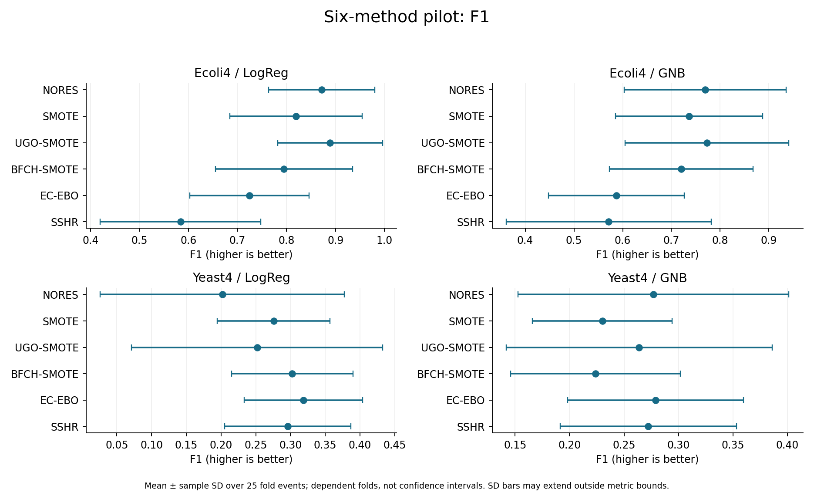
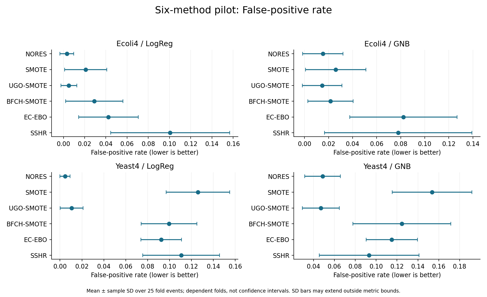
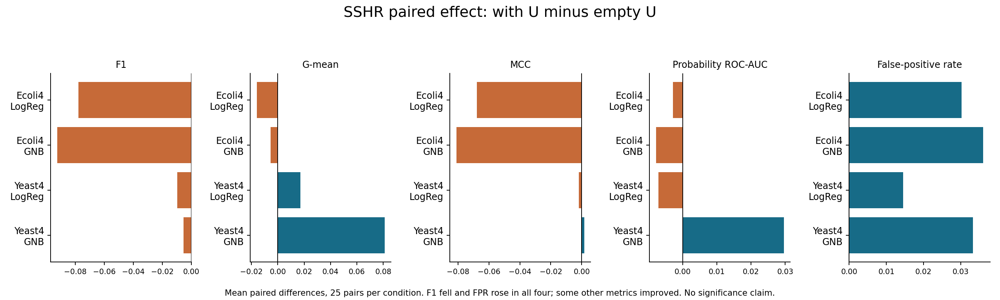
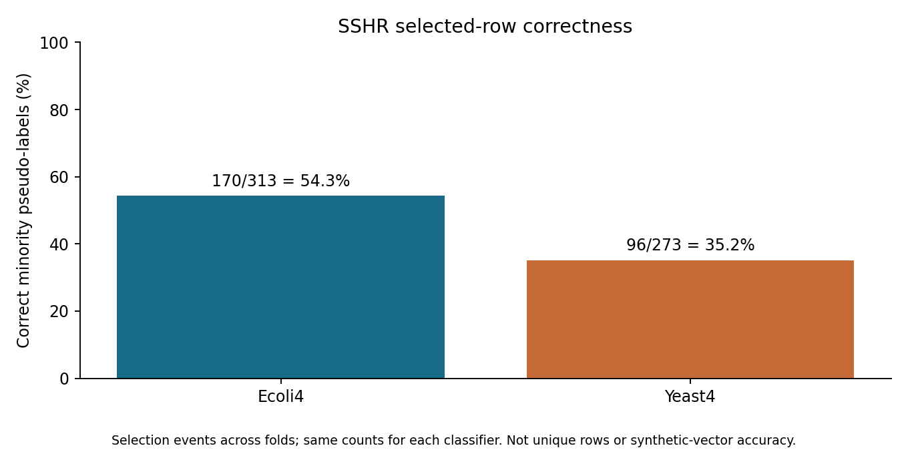
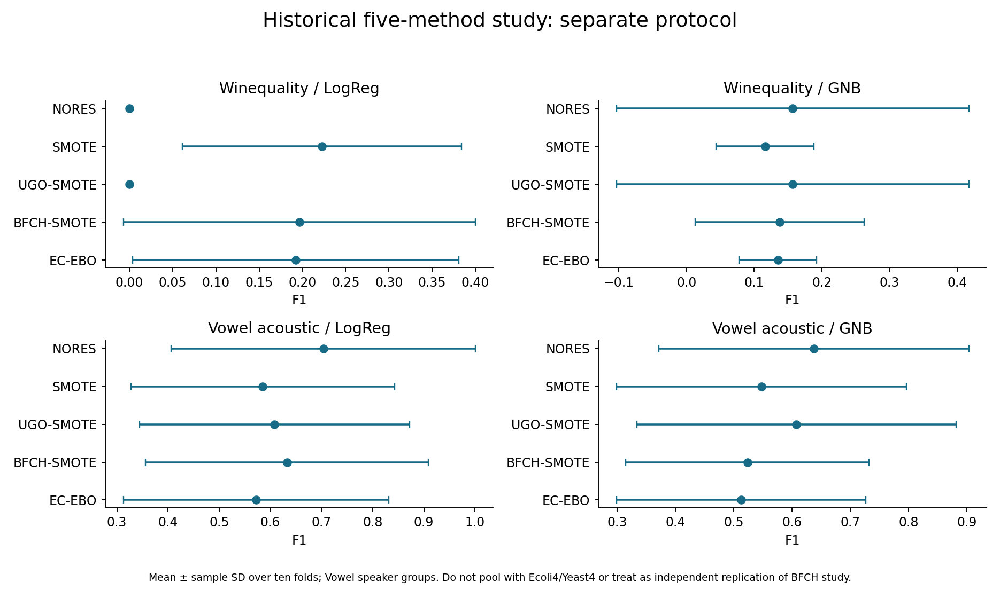

# Mid-Sem Evaluation Preparation — 14 October 2026

Project: Imbalanced Learning Reproductions (UGO, BFCH-SMOTE, EC-EBO and SSHR).
Repository: MAYANK-RATHVA05/rb_ugo. Working branch: sshr-implementation.
Prepared from saved study aggregates; no new training was run for this presentation.

## 1. What to say at the start

“Our project investigates class imbalance through audited implementations of four published resampling methods. We compare them under common evaluation conditions and study whether unlabelled training observations help SSHR. Our current contribution is reproduction engineering and controlled empirical analysis; a novel oversampling algorithm has not been established.”

Evidence: docs/PROJECT_SCOPE.md; docs/audit/claims_table.md; docs/audit/audit_protocol.md.

## 2. Three research questions and progress

| Question | Implemented work | What remains unproved |
| --- | --- | --- |
| A: Can boundary-focused generation avoid unnecessary overlap? | UGO and BFCH-SMOTE; training-only distance proxy | No guarantee of true overlap avoidance or correct synthetic labels |
| B: Can intra-class imbalance be handled? | EC-EBO clustering and sample allocation | Held-out minority-subregion improvement was not measured |
| C: Can unlabelled observations support minority augmentation? | SSHR clustering, pseudo-label selection and SMOTE fallback; paired U ablation | Broad benefit and exact author-code equivalence remain unverified |

SSHR admits existing unlabelled observations with inferred minority labels. Only its SMOTE fallback generates new feature vectors. Source: docs/SSHR_METHOD_DECISIONS.md, Algorithm 2 audit; docs/audit/audit_protocol.md.

## 3. Project Review suggestions: honest status

The official Project Review comments were not supplied in the available records. Before presenting, insert their exact wording and confirm the mapping below. Do not describe a suggestion as completed merely because it appears in this preparation guide.

| Item from available project discussions | Current evidence/status | Action before evaluation |
| --- | --- | --- |
| Reproduce previous papers before claiming an extension | Four audited implementations; all classified APPROXIMATION | Explain declared source ambiguities and departures |
| Compare methods fairly | Common L/folds/classifiers and training-only preprocessing | Show protocol and audit evidence |
| Investigate unlabelled data | Paired U/empty-U study and correctness audit complete | Show ablation and precision plots |
| Local safety and inverse-density extension | Proposal only; novelty unverified | Do not present as implemented or a measured result |
| Official reviewer-specific suggestion | UNVERIFIED: enter exact comment | Record completed/partial/pending plus a file or experiment as evidence |

Source: docs/audit/audit_protocol.md and contribution_and_qa.md; project discussion. UGO already relocates to the nearest clean same-class point, not a centroid (src/noise_detection.py; UGO Section 3.4). A centroid replacement is therefore not an established new contribution.

## 4. Explain the main experiment in one minute

Two numeric datasets: Ecoli4 and Yeast4. Two final classifiers: Logistic Regression (LogReg) and Gaussian Naive Bayes (GNB). Six methods: NORES, SMOTE, UGO-SMOTE, BFCH-SMOTE, EC-EBO and SSHR.

Five repeats of five outer folds give 25 held-out fold events per condition. Approximately half the training labels are retained as observed L; training-only U contains the other rows. Every baseline gets the same reduced L. Raw identical-coordinate groups stay together across train/test and L/U. Preprocessing fits L only; hidden labels audit selections afterward. Test data does not enter generation or parameter selection in the inspected pipeline.

The main matrix has 600 successful jobs. Empty-U SSHR and duplicated NORES controls add 200 jobs. All 800 saved jobs were audited. These are repeated fits, not 800 independent datasets. Sources: scripts/run_sshr_small_study.py; docs/audit/audit_protocol.md; docs/audit/audit_verification.json.

Metric meanings: F1 balances minority precision/recall; G-mean balances sensitivity/specificity; MCC summarizes confusion-matrix association; probability ROC-AUC measures ranking; FPR measures majority false alarms. Higher is better except FPR. Error bars below are sample SD, not confidence intervals or significance tests.

## 5. Main result: no universal winner

UGO-SMOTE has the highest mean F1 on Ecoli4 for both classifiers; EC-EBO has the highest mean F1 on Yeast4 for both classifiers. This is a descriptive ranking in this pilot. Sources: docs/audit/recomputed_scores.csv; docs/audit/audit_numbers.md.

For LogReg, Ecoli4 F1 is 0.8890 for UGO-SMOTE versus 0.8720 for NORES. Yeast4 F1 is 0.3189 for EC-EBO versus 0.2018 for NORES. Yeast4 LogReg FPR also rises from 0.0046 to 0.0923: report the cost alongside the gain.

## 6. Question C: what changed with unlabelled data?

With U minus empty U, mean SSHR F1 fell in all four conditions: Ecoli4/LogReg -0.0777, Ecoli4/GNB -0.0922, Yeast4/LogReg -0.0096, Yeast4/GNB -0.0054. FPR rose in all four. Yeast4/GNB ROC-AUC and G-mean improved, so “unlabelled data never helps” is unsupported. Source: docs/audit/recomputed_ablation.csv.

Correctness is 170/313 (54.3%) for Ecoli4 and 96/273 (35.2%) for Yeast4, separately for each classifier. Counts are selection events over repeated folds. Wrong pseudo-labels are a plausible contributor to harm, but this joint U ablation does not isolate the cause: U also changes clustering, cleaning and fallback. Source: docs/audit/pseudo_label_audit.csv; docs/audit/contribution_and_qa.md.

## 7. Contribution, limitations and next step

Completed contributions: auditable implementations with explicit paper ambiguities; a common controlled evaluation; a paired local U ablation; and retrospective quality/count/shortfall diagnostics. No novel method is established. Do not call a local observation first-in-literature without a prior-art review.

All four whole-method implementations are classified APPROXIMATION. SSHR uses a literal printed objective that can exceed one; held-out standard F1 is a different quantity and was independently verified. Two datasets and two classifiers cannot establish general superiority. Repeated folds share observations. No between-method significance analysis or tuned-threshold NORES control is available. BFCH has a distance proxy, not a true-overlap guarantee; EC-EBO lacks held-out subgroup recall. Sources: docs/audit/audit_protocol.md; claims_table.md.

Proposed next step — HYPOTHESIS ONLY: test whether an uncertainty-based admission filter improves SSHR pseudo-label quality and FPR without unacceptable loss of recall or candidate coverage. Resolve source ambiguities, check closest prior art and predeclare an independent confirmation protocol first. Do not tune against these already-inspected test outcomes. The broader local-safety/inverse-density idea remains unimplemented and its novelty is unverified.

## 8. Five-minute speaking plan

| Time | Show | What to say |
| --- | --- | --- |
| 0:00–0:35 | Questions A/B/C | State the three questions; do not claim they are solved |
| 0:35–1:05 | Scope and implementation files | Four published methods plus two controls; declared approximations |
| 1:05–1:55 | Protocol | Same L/folds; training-only U; 600+200 audited jobs |
| 1:55–2:45 | F1 and FPR plots | Mean leaders vary; report false-positive cost |
| 2:45–3:30 | Ablation and precision plots | F1 falls with U; low purity; other metrics can improve |
| 3:30–4:05 | Limitations | No significance, no novelty established, source ambiguities |
| 4:05–4:35 | Contribution | Reproduction, fair comparison and diagnostic analysis |
| 4:35–5:00 | Next step | A falsifiable hypothesis, not a completed result |

## 9. Questions to rehearse

| Supervisor question | Honest answer |
| --- | --- |
| What is new? | A project-level controlled analysis; algorithmic novelty is not established |
| Why does U hurt? | Incorrect pseudo-labels are plausible, but the experiment changes several components and does not prove the cause |
| Is the difference significant? | We report means and descriptive SDs; no between-method significance claim |
| Did you reproduce the complete papers? | No: declared implementation choices and small pilots; the complete UGO benchmark is unfinished |
| Why only two datasets here? | A controlled diagnostic pilot; broader confirmation remains necessary |
| Is SSHR generating new samples? | It mainly selects existing U rows; only fallback SMOTE generates new vectors |
| Have A and B been solved? | The methods target them; true-overlap guarantees and subgroup benefit are not established |
| Are hidden/test labels used? | Hidden labels design the simulation and later audit correctness, not sampler learning; test labels score final predictions |
| Where is the evidence? | CSV aggregates, method-decision documents and the independent audit |
| What did you personally do? | Describe each member’s actual work and credit original authors and tools; individual authorship was not audited |

More detailed answers: docs/audit/contribution_and_qa.md.

## 10. Antigravity demonstration and backup checklist

Use the local checkout C:\ugo\ugo_base and branch sshr-implementation. Cloud changes do not automatically update this folder. In its terminal run git status, git fetch origin, then git switch sshr-implementation and git pull --ff-only origin sshr-implementation if the working tree permits. If the branch does not exist locally, use git switch --track origin/sshr-implementation. If Git reports local changes or divergence, stop and preserve them; do not reset or force-pull.

Open this folder first: docs/presentation/midsem_2026_10_14/. Open Mid_Sem_Preparation.pdf in the system PDF viewer and keep the plots/ folder ready. In the editor, open README.md, docs/SSHR_SMALL_STUDY.md and docs/audit/audit_numbers.md; use Markdown preview if available. Open docs/sshr_pilot/ecoli4/scores.csv or yeast4/scores.csv when asked for underlying tables. No Python environment or retraining is needed to view these committed outputs.

For implementation questions open src/ugo.py, src/bfch_smote.py, src/ec_ebo.py, src/sshr.py and src/sshr_clustering.py. For run configuration open scripts/run_sshr_small_study.py. For diagnostics open each dataset’s diagnostics.csv, clusters.csv and ablation.csv under docs/sshr_pilot/.

Before leaving: confirm branch and latest commit; open the PDF and every figure offline; check official review suggestions; assign speaking roles honestly; copy the PDF/plots to a backup drive. Keep raw data, individual predictions and local paths out of projected screenshots. Do not launch the full benchmark during evaluation.

## 11. Inventory of other completed and partial experiments

These experiments used different protocols. Show them as separate backup evidence; do not merge their averages or count repeated control runs as independent replication.

| Study | Recorded coverage | Where to show it |
| --- | --- | --- |
| UGO simulation pilot | 300 successful jobs; reconstructed linear/nonlinear inputs; three classifiers | docs/reproduction/SIMULATION_PILOT.md |
| BFCH comparison | Winequality/Vowel; four methods; two classifiers; ten folds; 160 successful jobs | docs/BFCH_SMALL_STUDY.md and BFCH_SMALL_STUDY_SCORES.csv |
| EC-EBO comparison | Same two datasets; five methods; two classifiers; ten folds; 200 successful jobs | docs/EC_EBO_SMALL_STUDY.md and EC_EBO_SMALL_STUDY_SCORES.csv |
| Controlled six-method pilot | Ecoli4/Yeast4; 600 main + 200 ablation/control jobs | docs/SSHR_SMALL_STUDY.md; docs/sshr_pilot/ |
| Historical larger UGO benchmark | Interrupted: 28,919 saved jobs reported; 18 datasets terminal, including failures; full 74 incomplete | docs/reproduction/BENCHMARK_EXECUTION.md; original cache not in Git |

The historical inventory is based on recorded reports; this preparation build does not re-audit those earlier individual runs. A fresh Windows clone will have the tracked reports, not ignored job caches/raw datasets. Historical terminal jobs include failures; do not claim all succeeded.

## 12. Complete main-pilot metric table

Mean ± sample SD over 25 fold events. Sources: docs/audit/recomputed_scores.csv and original docs/sshr_pilot/<dataset>/scores.csv. All five metrics are shown; plots for G-mean, MCC and ROC-AUC are also in plots/.

### Ecoli4 / LogReg

| Method | F1 | G-mean | MCC | ROC-AUC | FPR |
| --- | --- | --- | --- | --- | --- |
| NORES | 0.8720 ± 0.1085 | 0.9009 ± 0.0929 | 0.8738 ± 0.1056 | 0.9955 ± 0.0071 | 0.0032 ± 0.0065 |
| SMOTE | 0.8194 ± 0.1350 | 0.9381 ± 0.0732 | 0.8158 ± 0.1397 | 0.9951 ± 0.0070 | 0.0210 ± 0.0199 |
| UGO-SMOTE | 0.8890 ± 0.1071 | 0.9287 ± 0.0863 | 0.8885 ± 0.1076 | 0.9951 ± 0.0072 | 0.0051 ± 0.0075 |
| BFCH-SMOTE | 0.7949 ± 0.1398 | 0.9492 ± 0.0579 | 0.7971 ± 0.1369 | 0.9960 ± 0.0058 | 0.0292 ± 0.0270 |
| EC-EBO | 0.7247 ± 0.1218 | 0.9373 ± 0.0586 | 0.7279 ± 0.1182 | 0.9940 ± 0.0100 | 0.0424 ± 0.0282 |
| SSHR | 0.5838 ± 0.1640 | 0.9331 ± 0.0342 | 0.6130 ± 0.1464 | 0.9916 ± 0.0130 | 0.1006 ± 0.0560 |

### Ecoli4 / GNB

| Method | F1 | G-mean | MCC | ROC-AUC | FPR |
| --- | --- | --- | --- | --- | --- |
| NORES | 0.7694 ± 0.1663 | 0.8661 ± 0.1214 | 0.7670 ± 0.1713 | 0.9871 ± 0.0160 | 0.0152 ± 0.0168 |
| SMOTE | 0.7363 ± 0.1511 | 0.8788 ± 0.1104 | 0.7348 ± 0.1543 | 0.9888 ± 0.0134 | 0.0260 ± 0.0251 |
| UGO-SMOTE | 0.7729 ± 0.1679 | 0.8664 ± 0.1218 | 0.7704 ± 0.1728 | 0.9871 ± 0.0160 | 0.0146 ± 0.0165 |
| BFCH-SMOTE | 0.7201 ± 0.1471 | 0.8521 ± 0.1165 | 0.7141 ± 0.1517 | 0.9850 ± 0.0145 | 0.0215 ± 0.0188 |
| EC-EBO | 0.5871 ± 0.1392 | 0.9093 ± 0.0748 | 0.6016 ± 0.1355 | 0.9838 ± 0.0254 | 0.0822 ± 0.0446 |
| SSHR | 0.5714 ± 0.2103 | 0.8580 ± 0.1589 | 0.5824 ± 0.2103 | 0.9757 ± 0.0264 | 0.0779 ± 0.0612 |

### Yeast4 / LogReg

| Method | F1 | G-mean | MCC | ROC-AUC | FPR |
| --- | --- | --- | --- | --- | --- |
| NORES | 0.2018 ± 0.1759 | 0.3050 ± 0.2242 | 0.2331 ± 0.1889 | 0.8718 ± 0.0652 | 0.0046 ± 0.0047 |
| SMOTE | 0.2757 ± 0.0811 | 0.7898 ± 0.0757 | 0.3083 ± 0.0798 | 0.8698 ± 0.0574 | 0.1258 ± 0.0290 |
| UGO-SMOTE | 0.2519 ± 0.1808 | 0.3961 ± 0.2717 | 0.2717 ± 0.1796 | 0.8737 ± 0.0615 | 0.0106 ± 0.0104 |
| BFCH-SMOTE | 0.3025 ± 0.0875 | 0.7739 ± 0.0807 | 0.3234 ± 0.0892 | 0.8545 ± 0.0682 | 0.0995 ± 0.0253 |
| EC-EBO | 0.3189 ± 0.0852 | 0.7854 ± 0.0746 | 0.3414 ± 0.0825 | 0.8705 ± 0.0667 | 0.0923 ± 0.0186 |
| SSHR | 0.2962 ± 0.0908 | 0.7935 ± 0.1284 | 0.3363 ± 0.0881 | 0.8781 ± 0.0729 | 0.1107 ± 0.0351 |

### Yeast4 / GNB

| Method | F1 | G-mean | MCC | ROC-AUC | FPR |
| --- | --- | --- | --- | --- | --- |
| NORES | 0.2768 ± 0.1243 | 0.5895 ± 0.1255 | 0.2580 ± 0.1268 | 0.8357 ± 0.0854 | 0.0488 ± 0.0171 |
| SMOTE | 0.2301 ± 0.0642 | 0.7598 ± 0.0857 | 0.2599 ± 0.0711 | 0.8187 ± 0.0847 | 0.1535 ± 0.0382 |
| UGO-SMOTE | 0.2639 ± 0.1220 | 0.5680 ± 0.1313 | 0.2438 ± 0.1254 | 0.8326 ± 0.0836 | 0.0470 ± 0.0177 |
| BFCH-SMOTE | 0.2239 ± 0.0779 | 0.6872 ± 0.1179 | 0.2312 ± 0.0917 | 0.7782 ± 0.0847 | 0.1246 ± 0.0469 |
| EC-EBO | 0.2789 ± 0.0807 | 0.7782 ± 0.0918 | 0.3065 ± 0.0881 | 0.8360 ± 0.0969 | 0.1150 ± 0.0246 |
| SSHR | 0.2722 ± 0.0810 | 0.7032 ± 0.1294 | 0.2825 ± 0.0821 | 0.8356 ± 0.0872 | 0.0933 ± 0.0477 |

## 13. Historical five-method metric table

Separate ten-fold protocol. Mean values below; sample SDs and source hashes are in docs/EC_EBO_SMALL_STUDY_SCORES.csv. The preceding BFCH study retains its own full tables in docs/BFCH_SMALL_STUDY_SCORES.csv.

### winequality_red_8_vs_6 / LogReg

| Method | F1 | G-mean | MCC | AUC | FPR |
| --- | --- | --- | --- | --- | --- |
| NORES | 0.0000 | 0.0000 | -0.0053 | 0.8739 | 0.0047 |
| SMOTE | 0.2225 | 0.6607 | 0.2535 | 0.8896 | 0.1394 |
| UGO-SMOTE | 0.0000 | 0.0000 | -0.0053 | 0.8739 | 0.0047 |
| BFCH-SMOTE | 0.1966 | 0.4836 | 0.1995 | 0.8612 | 0.1065 |
| EC-EBO | 0.1922 | 0.5445 | 0.1974 | 0.8763 | 0.1316 |

### winequality_red_8_vs_6 / GNB

| Method | F1 | G-mean | MCC | AUC | FPR |
| --- | --- | --- | --- | --- | --- |
| NORES | 0.1567 | 0.2105 | 0.1414 | 0.7843 | 0.0251 |
| SMOTE | 0.1161 | 0.5740 | 0.1285 | 0.7013 | 0.2147 |
| UGO-SMOTE | 0.1567 | 0.2105 | 0.1414 | 0.7843 | 0.0251 |
| BFCH-SMOTE | 0.1375 | 0.4740 | 0.1480 | 0.6212 | 0.1144 |
| EC-EBO | 0.1350 | 0.6616 | 0.1659 | 0.7819 | 0.2162 |

### vowel0_acoustic10_grouped / LogReg

| Method | F1 | G-mean | MCC | AUC | FPR |
| --- | --- | --- | --- | --- | --- |
| NORES | 0.7037 | 0.7851 | 0.7022 | 0.9636 | 0.0233 |
| SMOTE | 0.5851 | 0.8024 | 0.5723 | 0.9582 | 0.0884 |
| UGO-SMOTE | 0.6082 | 0.8070 | 0.5958 | 0.9565 | 0.0810 |
| BFCH-SMOTE | 0.6324 | 0.8271 | 0.6174 | 0.9569 | 0.0937 |
| EC-EBO | 0.5718 | 0.8011 | 0.5557 | 0.9502 | 0.1060 |

### vowel0_acoustic10_grouped / GNB

| Method | F1 | G-mean | MCC | AUC | FPR |
| --- | --- | --- | --- | --- | --- |
| NORES | 0.6375 | 0.8216 | 0.6332 | 0.9553 | 0.0626 |
| SMOTE | 0.5478 | 0.8229 | 0.5485 | 0.9538 | 0.1251 |
| UGO-SMOTE | 0.6074 | 0.8158 | 0.5997 | 0.9643 | 0.0860 |
| BFCH-SMOTE | 0.5236 | 0.7976 | 0.5080 | 0.9566 | 0.1354 |
| EC-EBO | 0.5129 | 0.8043 | 0.5089 | 0.9513 | 0.1394 |

## 14. UGO simulation results (historical report)

Mean MCC from docs/reproduction/SIMULATION_PILOT.md; reconstructed data, not author coordinates. Other simulation diagnostics and resource limitations remain in that report.

| Simulation | Classifier | NORES | UGO-ROS | UGO-SMOTE |
| --- | --- | ---: | ---: | ---: |
| Linear | LogReg | 0.5445 | 0.6402 | 0.6348 |
| Linear | GNB | 0.6478 | 0.6300 | 0.6328 |
| Linear | KNN | 0.6412 | 0.6305 | 0.6448 |
| Nonlinear | LogReg | 0.0000 | 0.0004 | 0.0602 |
| Nonlinear | GNB | 0.3024 | 0.5854 | 0.5992 |
| Nonlinear | KNN | 0.7285 | 0.7072 | 0.7132 |

## 15. Source and build record

All new plots use saved aggregates. source_manifest.json records hashes of the source tables/reports used by this build. Rebuild from the repository root with: python docs/presentation/midsem_2026_10_14/build_preparation.py. Document-only dependencies: matplotlib, python-docx, reportlab. No new experiment or source change is implied.

Detailed paper citations: docs/audit/paper_sources.md. Numerical audit: docs/audit/audit_numbers.md. Protocol/fidelity: docs/audit/audit_protocol.md. Existing study reports remain the authoritative historical records.
