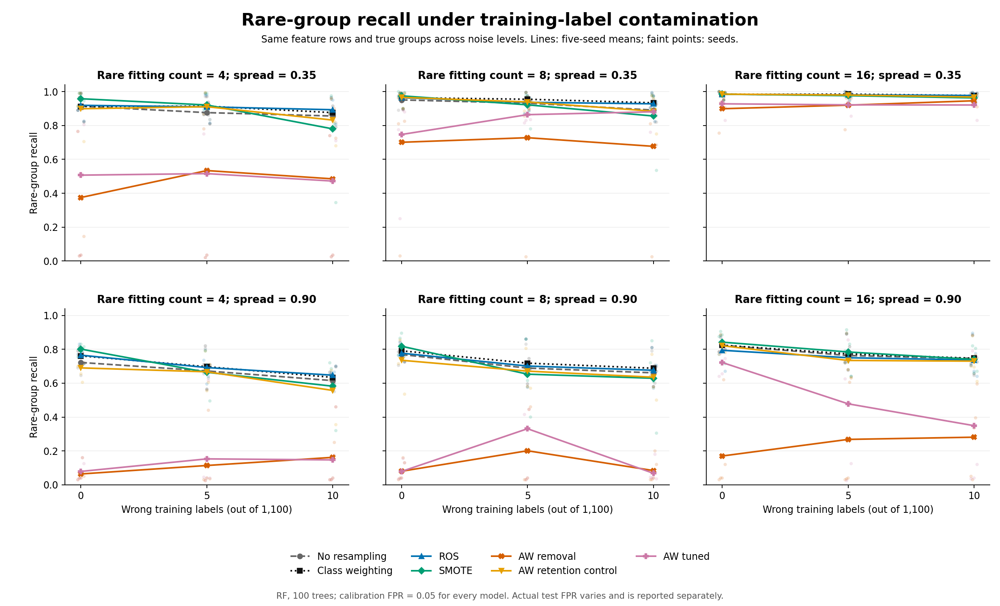
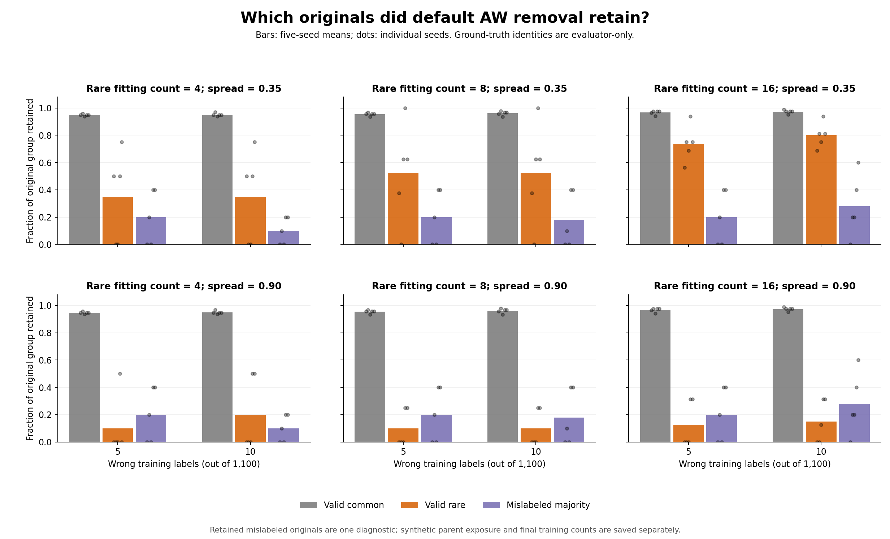
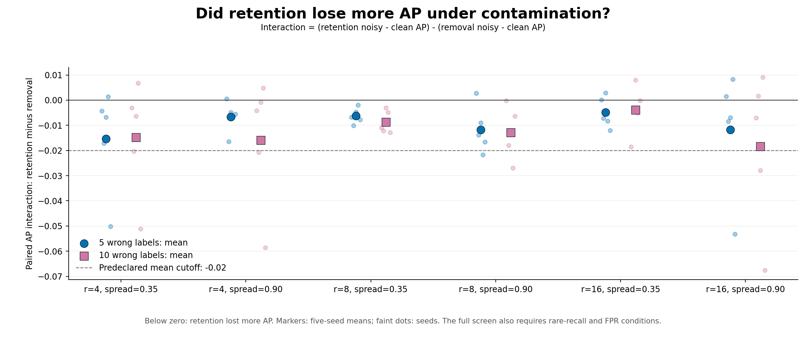

# Rare groups and training-label contamination: measured results

The experiment completed and its saved evidence passed audit. **The predeclared tradeoff trigger was not met: zero base settings qualified, with two required.** Retaining originals often protected rare-group recall, but the measured extra contamination cost was below the declared AP cutoff. Class weighting also met the ordinary-control tolerances in all six base settings across all three noise levels. This study does not justify a new oversampler.

## Run and experimental setup

- Frozen run commit: [`975020ab3cc3ba5e15cfd29499c7ee5b776a0116`](https://github.com/MAYANK-RATHVA05/rb_ugo/commit/975020ab3cc3ba5e15cfd29499c7ee5b776a0116), 19 October 2026. The design was fixed earlier in protocol commit `bff7ce5`; its [scientific configuration](../../../configs/rare_subgroups_contamination_v1.json) and [decision rules](CONTAMINATION_PROTOCOL.md) were unchanged.
- **90/90 cases, 630/630 method evaluations and 810/810 AW candidates succeeded**, using 1,260 classifier fits. No seed/case was retried, dropped or replaced. Measured cloud wall time: **352.6 seconds**; local runtime will differ.
- Six base settings: genuine rare fitting count 4/8/16 crossed with rare spread .35/.90. Each is evaluated with 0/5/10 wrong training labels and seeds 42–46: 18 settings × five seeds. These are related synthetic conditions, not 90 independent datasets or cross-validation folds.
- Fitting features always contain 1,000 true majority and 100 true minority observations in two dimensions. Within each paired noise triplet, only 0/5/10 majority labels change from 0 to 1; all features, true common/rare examples, row order and held-out data stay fixed. Five wrong labels are 0.4545% of all fitting rows and 4.7619% of observed positives; ten are 0.9091% and 9.0909%, respectively.
- Selection uses clean 2,000 majority/180 common/20 rare examples; calibration uses 2,000 independent clean negatives; testing uses 20,000 majority/1,800 common/200 rare examples. This extra clean supervision is part of the setup.
- All methods use the same fixed 100-tree random forest. Scaling fits on original fitting X. Generation budgets are 900/890/880 from observed class counts before cleaning; removing originals changes final totals. AW tuning uses aggregate selection AP and reuses the chosen fit. Hidden truth is evaluator-only.

This is a controlled follow-up to the [clean pilot](PILOT_RESULTS.md), separate from the earlier 30-dataset paper-method comparison. It uses our **AW-paper-conventions** implementation and the paired seed-filter-only retention ablation, not an exact verified paper reproduction or the paper's incompletely specified KeepNoise method. See the [source audit](AW_SMOTE_SOURCE_AUDIT.md).

## Rare-group recall across every setting

Each entry is a five-seed mean; higher is better. Full sample SDs and all other metrics are in [comparison.csv](contamination_v1/comparison.csv). This table does not average different metrics together.

| Rare count | Spread | Wrong labels | NORES | Weighted | ROS | SMOTE | AW remove | AW retain | AW tuned |
| ---: | ---: | ---: | ---: | ---: | ---: | ---: | ---: | ---: | ---: |
| 4 | 0.35 | 0 | 0.914 | 0.913 | 0.919 | 0.958 | 0.375 | 0.899 | 0.507 |
| 4 | 0.35 | 5 | 0.876 | 0.914 | 0.910 | 0.921 | 0.534 | 0.911 | 0.516 |
| 4 | 0.35 | 10 | 0.856 | 0.876 | 0.893 | 0.780 | 0.485 | 0.832 | 0.472 |
| 4 | 0.90 | 0 | 0.722 | 0.761 | 0.765 | 0.801 | 0.064 | 0.690 | 0.079 |
| 4 | 0.90 | 5 | 0.672 | 0.697 | 0.692 | 0.664 | 0.114 | 0.667 | 0.153 |
| 4 | 0.90 | 10 | 0.615 | 0.634 | 0.647 | 0.582 | 0.162 | 0.557 | 0.147 |
| 8 | 0.35 | 0 | 0.951 | 0.964 | 0.964 | 0.975 | 0.701 | 0.966 | 0.747 |
| 8 | 0.35 | 5 | 0.932 | 0.955 | 0.937 | 0.922 | 0.728 | 0.939 | 0.864 |
| 8 | 0.35 | 10 | 0.891 | 0.934 | 0.928 | 0.856 | 0.677 | 0.884 | 0.881 |
| 8 | 0.90 | 0 | 0.769 | 0.791 | 0.777 | 0.818 | 0.080 | 0.735 | 0.079 |
| 8 | 0.90 | 5 | 0.689 | 0.718 | 0.701 | 0.653 | 0.201 | 0.671 | 0.331 |
| 8 | 0.90 | 10 | 0.661 | 0.688 | 0.676 | 0.629 | 0.084 | 0.635 | 0.068 |
| 16 | 0.35 | 0 | 0.985 | 0.984 | 0.984 | 0.985 | 0.899 | 0.985 | 0.928 |
| 16 | 0.35 | 5 | 0.978 | 0.985 | 0.981 | 0.976 | 0.920 | 0.980 | 0.922 |
| 16 | 0.35 | 10 | 0.966 | 0.977 | 0.977 | 0.963 | 0.946 | 0.968 | 0.921 |
| 16 | 0.90 | 0 | 0.824 | 0.824 | 0.794 | 0.842 | 0.170 | 0.821 | 0.722 |
| 16 | 0.90 | 5 | 0.763 | 0.773 | 0.750 | 0.784 | 0.268 | 0.734 | 0.478 |
| 16 | 0.90 | 10 | 0.746 | 0.747 | 0.737 | 0.740 | 0.281 | 0.730 | 0.349 |



For an illustrative cell with eight genuine rare fitting examples, spread .90 and ten wrong labels, the five-seed means are:

| Method | Rare recall | Common recall | F1 | AP | Actual test FPR |
| --- | ---: | ---: | ---: | ---: | ---: |
| No resampling | 0.6610 | 0.9799 | 0.7700 | 0.9175 | 0.05158 |
| Class weighting | 0.6880 | 0.9791 | 0.7690 | 0.9217 | 0.05218 |
| AW removal | 0.0840 | 0.9882 | 0.7456 | 0.8491 | 0.05109 |
| AW retention | 0.6350 | 0.9811 | 0.7694 | 0.8917 | 0.05141 |

Class weighting reaches 68.8% rare recall versus 8.4% for default AW removal and 63.5% for retention. Those methods' actual mean test FPRs are close, but are still reported separately. Common recall and F1 show tradeoffs: retention's mean F1 is slightly above weighting here. This example does not establish one method as best on every metric or application.

## What cleaning removed

At ten wrong fitting labels, default AW removal retained these original-group fractions, averaged across seeds:

| Rare count | Spread | Valid common retained | Valid rare retained | Mislabeled majority retained |
| ---: | ---: | ---: | ---: | ---: |
| 4 | 0.35 | 95.0% | 35.0% | 10.0% |
| 4 | 0.90 | 95.0% | 20.0% | 10.0% |
| 8 | 0.35 | 96.1% | 52.5% | 18.0% |
| 8 | 0.90 | 96.1% | 10.0% | 18.0% |
| 16 | 0.35 | 97.4% | 80.0% | 28.0% |
| 16 | 0.90 | 97.4% | 15.0% | 28.0% |

Many legitimate rare observations are removed along with mislabeled majority observations. Greater rare spread changes overlap as well as density, so this is not evidence of a density-only causal effect.



Removing originals does not itself establish control of contaminated synthetic parents. Across the 30 related cases at each nonzero noise count, the mean fraction of **generated rows with at least one corrupted parent** was:

| Wrong labels | AW removal / retention | SMOTE | ROS duplicates with corrupted parent |
| ---: | ---: | ---: | ---: |
| 5 | 24.10% | 5.62% | 4.20% |
| 10 | 31.71% | 9.11% | 8.86% |

These are descriptive provenance fractions, not synthetic-class error rates. Parent identity cannot certify an interpolated point's true class. Removal and retention have exactly the same generated rows, including this exposure; they differ only in the originals retained for classifier fitting. Their comparison tests the extra cost of restoring originals, not the entire cost of corrupted-seed generation. [parent_exposure.csv](contamination_v1/parent_exposure.csv) contains every case, method and parent count. These observations can inform a later hypothesis, but the source paper already discusses reliability and probability regularization, so they do not establish novelty.

## Predeclared screen: complete outcome

A contaminated cell had to show both:

- **A, rare protection:** at least .05 mean rare-recall gain for retention over removal, positive in at least four seeds, actual rare-original loss, common-recall difference at least −.02, and mean absolute paired test-FPR difference at most .01.
- **B, contamination cost:** actual mislabeled-original removal and mean AP interaction at most −.02, negative in at least four seeds. Interaction is `(retention noisy AP − retention clean AP) − (removal noisy AP − removal clean AP)`.

At least two distinct base settings had to qualify. Here are all 12 contaminated cells; a cell qualifies only when both A and B are Yes:

| Rare count | Spread | Wrong labels | Rare-recall gain | Positive seeds | Mean absolute FPR difference | AP interaction | Negative seeds | A: rare protection | B: noise cost |
| ---: | ---: | ---: | ---: | ---: | ---: | ---: | ---: | --- | --- |
| 4 | 0.35 | 5 | 0.377 | 3/5 | 0.00314 | -0.01540 | 4/5 | No | No |
| 4 | 0.35 | 10 | 0.347 | 3/5 | 0.00126 | -0.01483 | 4/5 | No | No |
| 4 | 0.90 | 5 | 0.553 | 5/5 | 0.00467 | -0.00660 | 4/5 | Yes | No |
| 4 | 0.90 | 10 | 0.395 | 4/5 | 0.00149 | -0.01589 | 4/5 | Yes | No |
| 8 | 0.35 | 5 | 0.211 | 4/5 | 0.00481 | -0.00630 | 5/5 | Yes | No |
| 8 | 0.35 | 10 | 0.207 | 4/5 | 0.00124 | -0.00878 | 5/5 | Yes | No |
| 8 | 0.90 | 5 | 0.470 | 5/5 | 0.00359 | -0.01171 | 4/5 | Yes | No |
| 8 | 0.90 | 10 | 0.551 | 5/5 | 0.00092 | -0.01283 | 5/5 | Yes | No |
| 16 | 0.35 | 5 | 0.060 | 4/5 | 0.00279 | -0.00491 | 3/5 | Yes | No |
| 16 | 0.35 | 10 | 0.022 | 4/5 | 0.00338 | -0.00382 | 4/5 | No | No |
| 16 | 0.90 | 5 | 0.466 | 5/5 | 0.00471 | -0.01179 | 3/5 | Yes | No |
| 16 | 0.90 | 10 | 0.449 | 5/5 | 0.00377 | -0.01833 | 3/5 | Yes | No |

Nine cells satisfy A; **none satisfies B**, so none qualifies. Mean AP interactions range from about −.01833 to −.00382, all above the predeclared −.02 cutoff. Negative effects do occur, but their observed mean magnitude is insufficient for this screen. The rule was not relaxed or rounded into a pass. The saved status is **`tradeoff_trigger_not_met`**, not `simple_controls_suffice`, because the trigger check precedes the control check.



The separate [control-coverage table](contamination_v1/control_coverage.csv) nevertheless shows that class weighting covers all six base settings and NORES covers five. Coverage requires one control to meet rare/common recall, AP and paired-FPR tolerances relative to retention/removal at **each** of 0, 5 and 10 wrong labels. It is descriptive coverage of related settings, not statistical significance or permission to select methods using hidden test groups.

## Calibration, audit and limits

Every model achieved exactly **100/2,000 = .05 calibration FPR** using the predeclared independent random tie keys. Actual test FPR ranged from **.03355 to .06445**; 326 of 630 evaluations exceeded .05. Calibration is not a test/population guarantee, and the protocol still checks actual paired FPR differences.

All **210 zero-noise test probability vectors exactly matched the first pilot's corresponding vectors**. Thus the clean-case thresholded recall differences between the reports follow from the prospectively changed tie-calibration rule; the underlying probabilities did not change. Do not treat the two reports as if they used the same threshold rule.

The [audit](contamination_v1/audit.json) independently regenerated partitions and nested flips, verified shared features/true groups and original-only scaling, and reproduced all 810 candidate AP values and 630 calibration cutoffs/metric vectors. Maximum discrepancies were 2.23e-16 for selection AP and 4.45e-16 for held-out metrics. It reconstructed 720,900 AW candidate interpolations, 80,100 SMOTE interpolations and 80,100 ROS duplications, checked parent/retention counts and seed draws, and verified all summaries and screen/control decisions. DBSCAN labels were replayed with the reference library; distance/weight/quota arithmetic was independently reconstructed. No additional classifiers were trained for the audit. Pre-run verification passed **875 tests**.

The audit code is [available in the repository](../../../scripts/audit_rare_subgroups_contamination.py). Unlike the first pilot, this run saves selection and calibration probabilities, so their AP values and threshold cutoffs can be recomputed without refitting. Classifier training itself was not repeated; isolation rests on the checked source and software tests.

Limits: one classifier, five seeds, simple Gaussian components, mild one-way randomly placed training-label errors, clean selection/calibration labels, changing observed class ratios/generation budgets, and AW conventions disclosed in the source audit. Row retention also changes final fitting totals. Shared seeds/settings and observed differences do not establish generality, significance, exact published-score reproduction or noise robustness. These cutoffs are practical design choices; an unmet trigger does not prove that no problem exists elsewhere.

## Conclusion and files to show

**This study is complete; a new oversampler is not justified by these results.** Rare-group deletion and corrupted-parent amplification are useful diagnostics, while ordinary class weighting remains a strong control in this setup. Any next method-development hypothesis needs a separate literature check, prospective design and independent validation with meaningful real subgroup identities. No new sampler or further experiment has been implemented here.

For a supervisor discussion, show this report, the [three-page figure PDF](contamination_v1/figures/Rare_Subgroup_Contamination_Figures.pdf), and [comparison.csv](contamination_v1/comparison.csv). For evidence, use [seed-level scores](contamination_v1/scores.csv), [coverage](contamination_v1/coverage.csv), [paired changes](contamination_v1/paired_changes.csv), [screen decisions](contamination_v1/screen_decisions.csv), [audit](contamination_v1/audit.json) and [provenance](contamination_v1/provenance.json).

These compact files are committed under `docs/research/rare_subgroups/contamination_v1`, so Git pull is sufficient for viewing. Full 73.7 MiB checkpoints/vectors remain under ignored `results/rare-subgroups-contamination-v1` in the cloud checkout. Their identity belongs to frozen run commit `975020a`; later publication commits must use a fresh output directory for a new numerical run.

Regenerate figures from the published CSV without training:

```powershell
.\.venv\Scripts\python.exe -m scripts.plot_rare_subgroups_contamination
```

A complete raw-vector audit needs the full case/NPZ directory, not just the compact tables:

```powershell
.\.venv\Scripts\python.exe -m scripts.audit_rare_subgroups_contamination --input results\rare-subgroups-contamination-v1 --output results\contamination-audit-local.json
```

Add `--clean-reference results\rare-subgroups-pilot-v1` only when that first pilot's raw artifacts are also present; without it, the optional exact first-pilot comparison is explicitly reported as unchecked.
