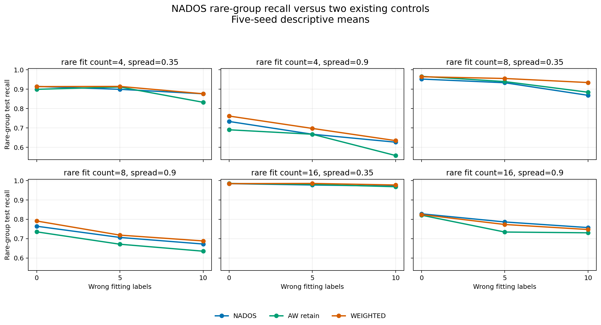
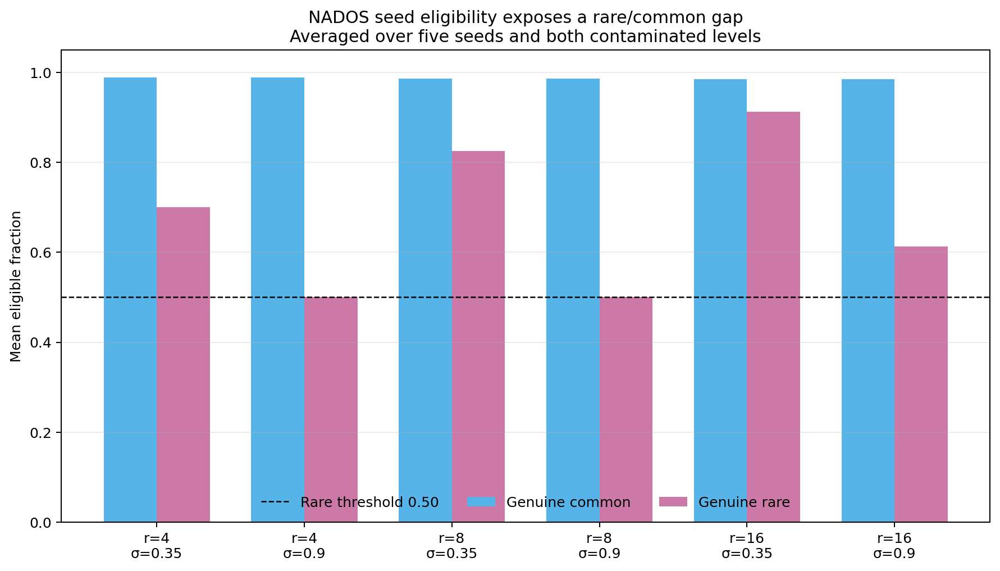
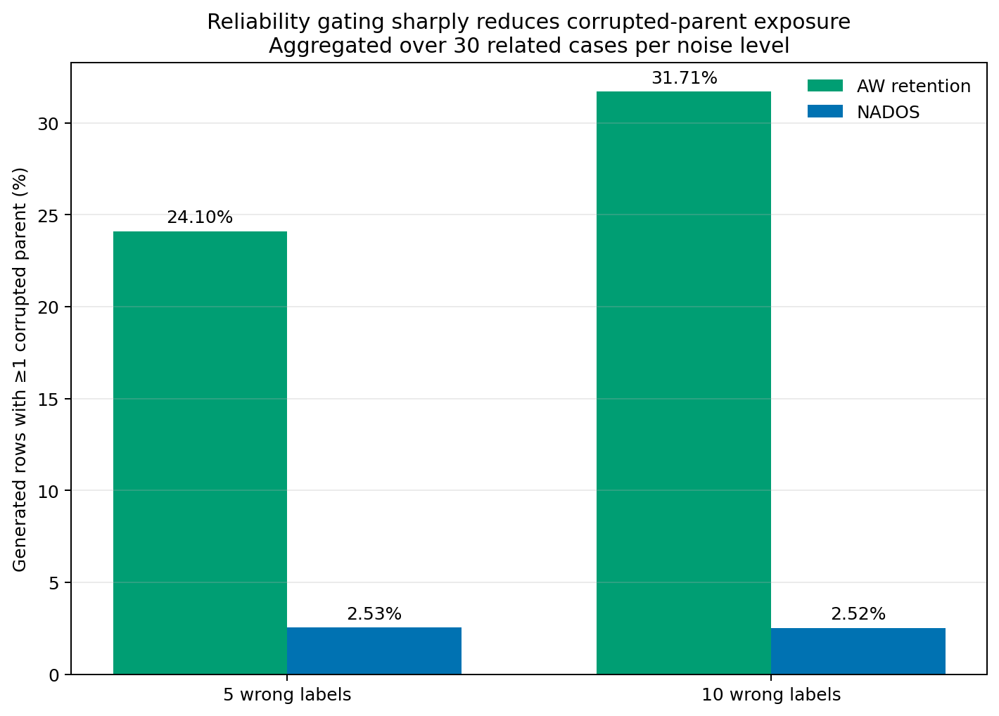

# NADOS rare-subgroup diagnostic: measured results

The authorized experiment completed and its full saved evidence passed a
read-only audit. **The frozen diagnostic trigger was not met: zero of 12
contaminated cells qualified, with two distinct base settings required.** NADOS
strongly reduced synthetic exposure to deliberately mislabeled observations,
but the predeclared rare-seed failure was not sufficiently consistent and
ordinary controls remained competitive. These results do not justify designing
a NADOS extension.

## Run and audit

- Run commit: `541cfaf1d1bf241f5e3cba97bb6ad9aaba974c13`.
- Scientific-design SHA-256:
  `c86301b697708983c3884256a0e055bde57f60ee3f7d8f5df5e42b6da9693b9f`.
- Parent contamination-design SHA-256:
  `adfdb2961963ff83b9552e84b06963689f938d853859d9bafc224106a08849db`.
- **90/90 cases and 90/90 NADOS rows succeeded**, using 90 random-forest
  fits. No failed case was dropped or replaced.
- All 80,100 generated rows were reconstructed from saved seed, partner and
  interpolation traces. Every saved array hash, case hash and artifact checksum
  passed.
- Every calibration produced exactly 100 positive predictions among 2,000
  independent known negatives. All test metrics were recomputed from saved
  probabilities and tie keys; maximum numerical discrepancy was
  `3.33e-16`.
- The audit fitted **zero classifiers**. Source fingerprints from the Windows
  run matched committed source after explicit CRLF/LF normalization.

The raw ZIP remains external because it is about 23 MB. Compact audited tables,
figures, provenance and the [audit summary](nados_v1/audit.json) are committed
under `nados_v1`.

## Experimental setup

The diagnostic reuses the exact 90 deterministic cases from the completed
[label-contamination study](CONTAMINATION_RESULTS.md): rare fitting counts
4/8/16, rare spreads .35/.90, wrong majority-to-minority training labels
0/5/10 and seeds 42–46. It also reuses fitting-only scaling, the fixed 100-tree
random forest, independent negative-only calibration and clean 20,000-majority,
1,800-common, 200-rare test partitions.

NADOS uses the fixed paper-aligned parameters `k=5`, reliability and difficulty
weights .5, reliability threshold .35 and target ratio 1.0. It retains every
original fitting observation and gates only which observed minority rows can
seed interpolation. Hidden true labels, subgroup IDs and corruption flags enter
diagnostics only after training.

These are six related synthetic base settings with five seeds, not 90
independent real datasets. The figures and averages below are descriptive.

## Overall comparison

The table averages 90 paired case-level results for each method. It should not
be read as a formal significance test or universal method ranking.

| Method | Rare recall ↑ | Common recall ↑ | Test FPR ↓ | F1 ↑ | AP ↑ |
| --- | ---: | ---: | ---: | ---: | ---: |
| Class weighting | **0.8408** | 0.9834 | **0.0490** | **0.7887** | **0.9332** |
| ROS | 0.8351 | 0.9834 | 0.0498 | 0.7857 | 0.9065 |
| **NADOS** | **0.8285** | **0.9833** | **0.0496** | **0.7860** | **0.8998** |
| SMOTE | 0.8249 | 0.9742 | 0.0497 | 0.7813 | 0.9070 |
| No resampling | 0.8228 | 0.9832 | 0.0495 | 0.7861 | 0.9277 |
| AW seed-filter retention | 0.8113 | 0.9846 | 0.0493 | 0.7866 | 0.9084 |
| Tuned AW removal | 0.5091 | 0.9855 | 0.0500 | 0.7694 | 0.8861 |
| Default AW removal | 0.4272 | 0.9867 | 0.0505 | 0.7642 | 0.8748 |

Compared case by case with class weighting, NADOS has mean rare-recall
difference −.0123, F1 difference −.0027 and AP difference −.0334. Compared
with no resampling, its rare-recall difference is +.0057 while its AP difference
is −.0279. NADOS clearly improves rare recall over AW removal, but simple
controls already avoid most of that removal failure.



## What reliability gating accepted

Across contaminated cases, NADOS accepted about 98.6–99.0% of genuine common
minority rows. Genuine rare eligibility depended on count and spread:

| Rare fit count | Spread | Common eligible | Rare eligible | Seeds passing both eligibility conditions per noise level |
| ---: | ---: | ---: | ---: | ---: |
| 4 | .35 | 0.9896 | 0.7000 | 2/5 |
| 4 | .90 | 0.9896 | 0.5000 | 3/5 |
| 8 | .35 | 0.9870 | 0.8250 | 0/5 |
| 8 | .90 | 0.9870 | 0.5000 | 3/5 |
| 16 | .35 | 0.9857 | 0.9125 | 0/5 |
| 16 | .90 | 0.9857 | 0.6125 | 1/5 |

The frozen eligibility condition required rare eligibility at most .50 and a
common-minus-rare gap of at least .20 in **four of five seeds**. No base/noise
cell reached four seeds. The table is unchanged between the two contaminated
levels for the number of passing seeds; complete seed-level values are in
[eligibility.csv](nados_v1/eligibility.csv).

NADOS accepted only 6 of 150 deliberately mislabeled seed candidates at the
five-flip level (4%) and 6 of 300 at the ten-flip level (2%). This shows that
the reliability gate usually recognized these isolated noisy observations.



## Corrupted-parent exposure

Among all 53,100 generated rows in contaminated cases, NADOS used at least one
corrupted parent for **1,342 rows (2.53%)**. AW seed-filter retention used at
least one corrupted parent for **14,807 rows (27.89%)** under the same case and
generation budgets. The aggregate relative reduction is **90.94%**.

| Wrong fitting labels | NADOS | AW retention |
| ---: | ---: | ---: |
| 5 | 2.53% | 24.10% |
| 10 | 2.52% | 31.71% |

All 12 contaminated cells passed the exposure cutoff requiring NADOS exposure
to be at most half the AW-retention value. Parent identity measures exposure to
an observed label error; it does not prove the true class of a synthetic point.



## Frozen-screen decision

For a cell to qualify, all three components had to hold:

1. the rare/common eligibility failure occurs in at least four of five seeds;
2. NADOS rare recall is at least .05 below a comparable existing control with
   mean absolute paired test-FPR difference at most .01;
3. corrupted-parent exposure is no more than half the AW-retention exposure.

The exposure gate passed in 12/12 cells. The performance gate passed in only
one cell (`rare count=8`, `spread=.35`, `wrong labels=10`). The eligibility gate
passed in **0/12**, so no cell qualified and no base setting qualified. This
conclusion does not depend on which comparable control is called “best,” because
the first required gate already fails everywhere. Full component values are in
[screen_decisions.csv](nados_v1/screen_decisions.csv).

The recorded status is **`diagnostic_trigger_not_met`**. The thresholds were not
relaxed after seeing the outcome.

## Reporting correction and limitations

The raw runner's `reports/scores.csv` had a naming collision: the held-out metric
`rare_count=200` overwrote the fitting design count in the column originally
called `rare_count`. The case JSON, NPZ vectors, case IDs and all numerical
metrics were correct. The audited [scores.csv](nados_v1/scores.csv) uses the
unambiguous columns `fit_rare_count` and `rare_count`; a regression test now
protects this export.

Limits include synthetic two-dimensional Gaussian data, one fixed classifier,
five seeds, mild one-way random label errors, clean calibration/test data and a
paper-aligned NADOS implementation without author-code verification. Eligibility
is a seed-generation diagnostic; rejected rows remain in training because NADOS
retains all originals. The study does not establish statistical significance,
real-data generality, noise robustness, novelty or theoretical guarantees.

## Conclusion and files to show

NADOS provides a useful positive result—strong control of corrupted-parent
generation while retaining all originals—but **our proposed research extension
is not supported by its frozen screen**. Rare rows are gated more often than
common rows, yet the effect was not consistent enough, and class weighting was
stronger on the main aggregate rare-recall and AP measurements. Implementing a
new NADOS variant now would be post-outcome method invention rather than the
predeclared next step.

For a supervisor discussion, show this report, the
[three-figure PDF](nados_v1/figures/NADOS_Diagnostic_Figures.pdf),
[comparison.csv](nados_v1/comparison.csv),
[screen decisions](nados_v1/screen_decisions.csv), and
[audit.json](nados_v1/audit.json). Regenerate the compact audit from full raw
artifacts without refitting classifiers:

```powershell
.\.venv\Scripts\python.exe -m scripts.audit_rare_subgroups_nados `
  --input results\rare-subgroups-nados-v1 `
  --publish-dir results\nados-audit-local
```

Regenerate figures from the committed compact tables:

```powershell
.\.venv\Scripts\python.exe -m scripts.plot_rare_subgroups_nados
```
