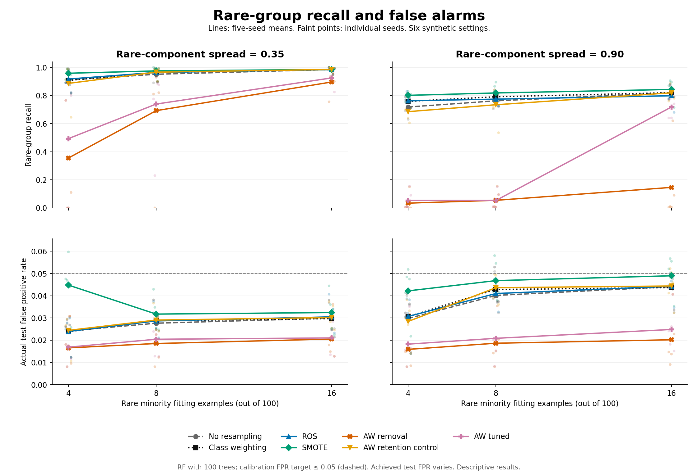
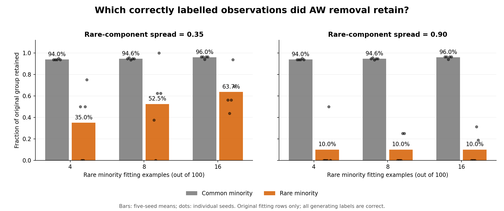

# First rare-subgroup pilot: measured results

The frozen pilot completed successfully, but **the predeclared criterion for advancing a new sampler was not met**. AW-style removal discarded valid rare observations and often reduced their recall. Keeping original observations or using ordinary baselines already worked well on this clean synthetic problem. This is evidence for measuring subgroup performance, not evidence of a novel oversampler.

## Run and coverage

- Frozen run commit: [`96671d7536dabf1a6f7a4d3a628b80e371aa472f`](https://github.com/MAYANK-RATHVA05/rb_ugo/commit/96671d7536dabf1a6f7a4d3a628b80e371aa472f), 19 October 2026.
- **30/30 cases, 210/210 method evaluations and 270/270 AW selection candidates succeeded**, using 420 classifier fits. No cases were retried, dropped, or replaced. Wall time was approximately 94.9 seconds in this cloud checkout; local runtime will differ.
- Six settings: rare fitting count 4/8/16 crossed with rare-component spread .35/.90, each with seeds 42–46. These are related synthetic settings, not 30 independent real datasets.
- Each fitting set has 1,000 majority and 100 minority observations. The test set has 20,000 majority, 1,800 common minority and 200 rare minority observations. Selection validation and negative-only calibration are separate partitions.
- The classifier is the same fixed 100-tree random forest for all methods. Every generating treatment requests 900 new observations from original class counts. AW removal can therefore change the final class ratio by excluding originals.

All original labels are correct in this first pilot. Group identities are used only for evaluation/diagnostics. The method is our **AW-paper-conventions** implementation; the [source audit](AW_SMOTE_SOURCE_AUDIT.md) explains why it is not an exact verified author-paper reproduction. No UGO/BFCH/EC-EBO/SSHR comparison is claimed for this experiment.

## Rare-group recall

Each entry is the mean of five seed-level test recalls, at a threshold selected independently for that model from calibration negatives. Higher is better. Full sample SDs and the other metrics are in [comparison.csv](pilot_v1/comparison.csv); every seed-level result is in [scores.csv](pilot_v1/scores.csv).

| Rare fitting count | Spread | NORES | Weighted | ROS | SMOTE | AW removal | AW retention | AW tuned |
| ---: | ---: | ---: | ---: | ---: | ---: | ---: | ---: | ---: |
| 4 | .35 | .910 | .907 | .917 | .958 | .355 | .886 | .493 |
| 4 | .90 | .718 | .758 | .762 | .801 | .034 | .685 | .053 |
| 8 | .35 | .951 | .964 | .964 | .975 | .692 | .966 | .739 |
| 8 | .90 | .762 | .791 | .774 | .818 | .054 | .734 | .053 |
| 16 | .35 | .985 | .984 | .984 | .985 | .896 | .985 | .925 |
| 16 | .90 | .819 | .820 | .798 | .843 | .146 | .819 | .718 |

AW retention restores originals around **identical synthetic rows**; it does not allow excluded observations to become seeds. It is an ablation, not the paper's incompletely specified KeepNoise algorithm. AW tuned selects among nine configurations using aggregate validation AP, not subgroup recall, and reuses its chosen fitted model.

The seed variation matters: AW-removal recall for count 4/spread .35 was .355 with sample SD .441; NORES was .910 with SD .063. The means are descriptive, not significance tests.



The top panels show a rare-group loss under default AW removal. The bottom panels show that methods do not achieve identical false-positive rates. Those operating-point differences must accompany the recall comparison.

## What cleaning removed, and why F1 can hide it

Across settings, default AW removal retained roughly **94–96% of common minority originals**, but only **10–64% of rare originals**, averaged over seeds. In all three spread-.90 settings it retained only 10% of rare originals on average. These discarded observations are valid according to the generator, not injected label errors.



For count 4/spread .35, compare these five-seed means:

| Method | Rare recall | Common recall | F1 | Actual test FPR |
| --- | ---: | ---: | ---: | ---: |
| NORES | .910 | .9864 | .8822 | .02418 |
| AW removal | .355 | .9808 | .8817 | .01657 |
| AW retention | .886 | .9867 | .8801 | .02445 |

F1 is nearly the same for NORES and AW removal despite their large rare-group recall difference. The rare group contributes only 10% of test positives, and the false-positive counts also differ. This is why the project must examine subgroup recall, common recall and FPR alongside aggregate scores. It does not show that retention has a free performance benefit at a perfectly matched operating point.

## The predeclared screening result

The [unchanged protocol](PILOT_PROTOCOL.md) required a mean retention-minus-removal rare-recall gain of at least .05, positive differences in at least four of five seeds, some original-group loss, and a mean **absolute paired** test-FPR difference no larger than .01. At least two settings had to qualify. Here is the complete screen:

| Rare count | Spread | Mean rare-recall gain | Positive seeds | Mean absolute paired FPR difference | Qualifies |
| ---: | ---: | ---: | ---: | ---: | --- |
| 4 | .35 | .531 | 4/5 | .007880 | Yes |
| 4 | .90 | .651 | 5/5 | .012560 | No: FPR difference |
| 8 | .35 | .274 | 4/5 | .010790 | No: FPR difference |
| 8 | .90 | .680 | 5/5 | .024960 | No: FPR difference |
| 16 | .35 | .089 | 4/5 | .010010 | No: FPR difference |
| 16 | .90 | .673 | 5/5 | .024190 | No: FPR difference |

Only **one setting qualified; two were required**, so the saved status is `trigger_not_met`. The count-16/spread-.35 case narrowly exceeds .01; it is not rounded into a pass or used to relax the rule after observing results. In the one qualifying setting, both ROS and class weighting meet the predefined ordinary-control tolerances relative to retention. NORES also has high rare recall there, as the table shows.

All empirical calibration FPRs were at most .05, but actual test FPR ranged from .0081 to .0597; 12 of the 210 evaluations exceeded .05 on test data. The calibration target is a finite-sample ceiling, not exact operating-point matching or a population guarantee. Discrete forest scores and ties can make the achieved calibration FPR much lower than the ceiling.

## Verification and practical limits

The pre-run software suite passed **824 tests**. The post-run [audit](pilot_v1/audit.json) checked all 30 case/prediction checksums, regenerated partition fingerprints, source fingerprints, fitting-only scaling, candidate radius/neighbors, cluster weights/quotas/probabilities, interpolation/output hashes, shared retention generation and selection ordering. It independently recomputed all seven held-out metrics for 210 prediction vectors, with maximum absolute discrepancy below 5e-16. It checked **243,000 interpolations across 270 candidate traces** and trained no additional classifiers.

The raw artifacts do not contain validation/calibration probability vectors. Their AP values and threshold minimality were therefore not independently recomputed from raw vectors without refitting; the audit verified recorded selection ordering and calibration count bounds, backed by the software isolation/arithmetic tests. See [run_manifest.json](pilot_v1/run_manifest.json) and [provenance.json](pilot_v1/provenance.json) for the exact run identity and artifact fingerprints.

This is one classifier, two Gaussian minority components, five seeds, clean labels and declared AW conventions. Rare-component spread changes overlap as well as density; changing rare fitting count also changes common fitting count at fixed total. Original-row retention changes final training totals. Correlated synthetic settings and observed differences do not establish statistical significance, generality, exact published-paper reproduction, or new-method novelty.

## Decision and files to use

**Do not claim a new oversampling method from this pilot.** It confirms a practical reason to monitor rare groups, while ordinary baselines already preserve them in this clean setting. Before designing a new sampler, a separately specified follow-up should distinguish genuine rare groups from mislabeled observations, retain strong NORES/ROS/weighted controls, and address achieved-FPR comparability. That follow-up has not been implemented or run here.

For a supervisor discussion, show this report, the [two-page figure PDF](pilot_v1/figures/Rare_Subgroup_Pilot_Figures.pdf), and [comparison.csv](pilot_v1/comparison.csv). The other published files provide seed-level scores, coverage, SDs and screening evidence. They are committed under `docs/research/rare_subgroups/pilot_v1`; pulling Git is sufficient to view them. Full 18 MB case checkpoints/predictions remain local under ignored `results/rare-subgroups-pilot-v1` in the cloud checkout.

To regenerate the figures from the published CSV without training:

```powershell
.\.venv\Scripts\python.exe -m scripts.plot_rare_subgroups_pilot
```

To repeat the numerical study locally, use the runner's explicit command and a fresh output directory. The original cloud checkpoints belong to run commit `96671d7`; later publication commits have a different manifest identity and cannot silently resume that directory.
